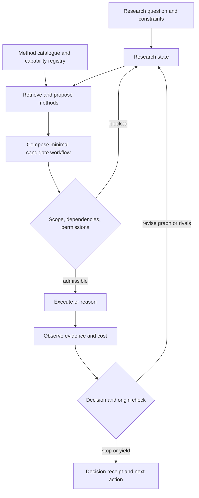

# Skill-Workshop

**A Research-Oriented Framework for Semi-Autonomous Intelligence**

Skill-Workshop is an experimental framework for extending the research capabilities of AI agents through composable skills, structured research methodologies, and reproducible execution.

Its objective is not to replace human researchers or merely automate repetitive tasks, but to establish a productive research system in which human judgment, model intelligence, specialized skills, and computational tools work together.

## Research Objectives

- Develop semi-autonomous research workflows that preserve the researcher's original intent.
- Improve hypothesis generation, experimental design, critical reasoning, and verification.
- Investigate when external skills provide measurable benefits beyond native model capabilities.
- Support persistent research continuity across sessions, models, tools, and execution environments.
- Reduce unnecessary procedural complexity without sacrificing scientific rigor.

## Design Principles

- **Research First** — Scientific progress takes precedence over infrastructure expansion.
- **Goal Fidelity** — Preserve the original research objective throughout execution.
- **Composability** — Combine specialized capabilities when they provide demonstrable value.
- **Evidence Integrity** — Preserve provenance, uncertainty, counterexamples, and negative results.
- **Adaptive Autonomy** — Adjust the degree of automation to the task and available evidence.
- **Empirical Evaluation** — Evaluate skills against meaningful baselines and real research tasks.

## Historical Background

Skill-Workshop originated in 2026 from research methodologies developed across multiple independent research projects.

Earlier generations introduced specialized research skills, integrated execution frameworks, evidence management, adversarial evaluation, and cross-session research continuity. These developments subsequently contributed to Research OS.

The project is now undergoing a fundamental reassessment of its architecture and methodology in light of advances in AI models and agentic execution environments.

## Development Status

Historical review and architectural reassessment.

Previous releases are retained as historical reference artifacts. The next implementation will be guided by empirical evidence rather than unconditional inheritance of legacy components.

## Architectural Research Direction — Adaptive Research Composition

**Status: design proposal (2026-11-27), not an implemented release.** The former 21-skill topology is historical, not a requirement for the next generation. Preserve useful behavior and consumer contracts rather than the number, names, or internal boundaries of modules. Existing experiment planners under `experiments/` remain isolated prototypes, not the core runtime.

### The problem

A research system must choose not only the next experiment, but also the methods by which it frames a question, acquires evidence, attacks assumptions, revises its own approach, and allocates resources. A static checklist fails when the bottleneck changes; a free-form agent can forget useful methods, repeat work, or overstate evidence. We seek a small, dynamically composed research workflow that makes observable progress under bounded resources.

### Responsibility boundaries

- **Research OS** owns lab identity, current doctrine, canonical sources, cross-lab method status, research authority, and long-term custody.
- **Skill-Workshop** discovers, selects, adapts and composes research capabilities under those contracts. It does not create a second Research OS.
- **Model hosts and tools** supply reasoning and execution. Tool availability is verified, not inferred from a historical host name.
- **The researcher** owns the research objective, major direction changes and consequential actions requiring approval.

### Proposed architecture

The state is a shared, typed research workspace containing the question, live uncertainty, rivals, evidence references, available resources, candidate actions and the current research decision. A short control loop assembles a task-local graph from capabilities instead of imposing a permanent pipeline.



The control layer should support two operating gears: low-overhead exploration (learn, apply, extend) and evidence promotion (claim-scoped verification). A simple task may require only one operation; the full loop is not mandatory ceremony.

### Capability and method contracts (draft)

A capability is a callable or instruction-level operation. A method is a transferable, conditional research strategy using one or more capabilities. A workflow is a temporary composition for the current bottleneck. They must not be treated as synonyms.

```ts
type Capability = {
  id: string;                 // stable semantic identity
  revision: string;
  requires: Port[];
  provides: Port[];
  preconditions: Predicate[];
  authorityCeiling: Authority;
  sideEffects: EffectClass[];
  costEstimate: CostVector;
  verify: VerificationContract;
  failure: FailureContract;
};

type Method = {
  id: string;
  sourceRevision: string;
  applicableWhen: Predicate[];
  assumptions: string[];
  expectedDecisionChange: string;
  transferFalsifier: string;
  candidateCapabilities: string[];
  status: MethodStatus;
};

type ResearchState = {
  goal: Goal;
  currentUncertainty: string;
  rivals: Rival[];
  evidence: EvidenceRef[];
  budget: Budget;
  decisions: DecisionReceipt[];
  pending: Action[];
};
```

A port carries semantic scope, claim scope, provenance roots, freshness, and authority mode. Authority is not a scalar and cannot be increased by routing or summarization. A typed edge is permitted only when its preconditions, scope, freshness, and provenance are satisfied. A loop may change research state but cannot create circular justification for a claim.

### Adaptive selection, execution and revision

```text
load current doctrine and objective
while budget and authorization permit:
    identify the current bottleneck
    retrieve a small set of relevant methods and native capabilities
    propose rival actions, including a no-skill direct baseline
    reject incompatible, unauthorized, or redundant compositions
    choose the smallest admissible plan likely to change a decision
    execute ready actions; parallelize only independent operations
    observe actual outcomes, provenance, failures, and resource usage
    update evidence and rival hypotheses
    repair, shrink, fork, stop, or recompose when the result changes the decision
    if no decision value remains: yield or stop with the reason
return the artifact, evidence-scoped judgment, and next authorized action
```

Selection estimates must be separated from measured results. Cost includes model tokens, elapsed time, tool calls, human review and recovery burden. A tentative utility model may rank admissible actions by expected decision improvement minus cost, but cannot override permissions, frozen evidence, or scientific authority. Use sensitivity analysis rather than optimizing an arbitrary composite score. A method that contributes no decision value may be dropped. Do not require a full graph rebuild after every operation.

### Research OS compatibility — preserve semantics, not topology

The following mapping is a **proposed compatibility register**, not evidence that replacements have passed equivalence tests. Historical names remain resolvable and prior records remain immutable. New capabilities may provide multiple legacy contracts or split a contract; a single alias is insufficient when old input/output semantics differ.

| Legacy contract(s) | Candidate semantic capability family | Consumer obligation |
| --- | --- | --- |
| RAVEL, ORBIT | Research control and branch selection | Explanandum lock, actual action mutation, bounded continuation, dependency-aware branching |
| NAPKIN, AXIOM, PIVOT, PRISM, LANTERN | Idea formation and critical inquiry | Preserve origin, generate rivals, expose assumptions and falsifiers, never confuse critique with verdict |
| SCOUT | Source and method discovery | Canonical-first retrieval, source/edition status, missing-source distinction |
| FORGE, ADAPTER, HARBOR, STEWARD | Execution and continuity | Artifact verification, interface deltas, environment equivalence, lawful resumption |
| SENTINEL, COURT | Admission and claim adjudication | Separate action permission from scientific evidence and claim authority |
| TRACE, ATLAS, CACHE | Evidence and research state | Preserve source roots, decisions, failure history, semantic owner, freshness and bounded retrieval |
| MOSAIC | Composition and synthesis | Preserve conflicts, common provenance, claim-specific inheritance |
| RHETOR, HUMANIZER, KWRITE | Research communication and evaluation | Preserve author intent, factual scope, comparative editing and evaluation |

Compatibility must be tested at the actual consumer boundary, not merely by comparing names or prompt text. Example: when the observation interface changes, ADAPTER's contract delta precedes HARBOR's environment comparison if that comparison depends on the interface; the comparison then precedes STEWARD's continuation judgment when resumption depends on equivalence. CACHE cannot establish its own authority by reading a prior projection. Equivalent actions may commute only under explicit independence conditions.

Migration protocol:
1. Inventory actual references in current Research OS contracts, Method records and lab-local doctrines; distinguish binding, optional, and historical references.
2. Record stable contract IDs, source revisions, consumers, required semantics, outputs, and prohibitions.
3. Implement a versioned resolver and compatibility shims only for real consumers. Unknown or ambiguous semantics hold rather than silently choosing a replacement.
4. Run original regression witnesses and new end-to-end consumer fixtures in shadow mode; compare decisions, not merely successful execution.
5. Promote only verified mappings with explicit rollback; preserve the 2.4.4 package and historical names. Research OS changes require their own scoped review.

### Methodological inheritance

Retain the RAVEL distinction between critique that changes the next action and ceremonial review. Retrieve methods according to the live uncertainty, not fixed checklists. Methods can be transferred without transferring the originating lab's empirical evidence. Keep discovery, execution, evidence, claim support, generalization and recommendation priority distinct. LIRA-style local preference ratings and JEV-style evidence/claim/generalization judgments are optional task-specific operators; their scores are not calibrated truth probabilities.

### Evaluation before implementation expansion

Use equal-budget comparisons on held-out tasks: native model without Workshop, fixed legacy pipeline, direct method retrieval, and adaptive composition. Separate objective correctness and externally verified results from subjective judgment. Measure wall time, cost, human interventions, failure recovery, unnecessary method calls, goal retention, and authority violations. Test on mathematical reasoning, empirical code replication, literature discovery, and research writing; keep training/development tasks separate from the final evaluation. Do not label synthetic graph fixtures as broad research-agent performance.

Initial negative cases: obsolete method invocation; an apparently successful tool result with no decision value; two methods with shared evidence roots; an unavailable capability; a critique that invalidates the current plan; budget exhaustion; a source version conflict; and a proposed goal change that requires owner approval.

### Literature and implementation research

- Hayes-Roth (1985), [A Blackboard Architecture for Control](https://doi.org/10.1016/0004-3702(85)90063-3): opportunistic control, distinct desirability and feasibility decisions.
- Erol et al. (1994), [Semantics for Hierarchical Task-Network Planning](https://www.cs.umd.edu/~nau/papers/erol1994semantics.pdf): structured decomposition and planning semantics.
- Khattab et al. (2024), [DSPy](https://arxiv.org/abs/2310.03714); Opsahl-Ong et al. (2024), [MIPRO](https://arxiv.org/abs/2406.11695): declarative modules and pipeline optimization.
- Hu et al. (2024), [Automated Design of Agentic Systems](https://arxiv.org/abs/2408.08435); Zhang et al. (2025), [AFlow](https://arxiv.org/abs/2410.10762): workflow search and composition.
- Wang et al. (2025), [Agent Workflow Memory](https://proceedings.mlr.press/v267/wang25bx.html): reuse of learned routines.
- Kim et al. (2024), [LLMCompiler](https://proceedings.mlr.press/v235/kim24y.html); Kapoor et al. (2024), [AI Agents That Matter](https://arxiv.org/abs/2407.01502): scheduling and cost-aware evaluation.
- Chen et al. (2025), [ScienceAgentBench](https://arxiv.org/abs/2410.05080); Starace et al. (2025), [PaperBench](https://arxiv.org/abs/2504.01848); Lu et al. (2024), [The AI Scientist](https://arxiv.org/abs/2408.06292): research-task assessment, reproduction, and automated research workflows.

These are method donors and competing approaches, not evidence that Skill-Workshop is novel or superior. The next milestone is the dependency census and design falsification, not an immediate new implementation or release.

## Research design notes

- [Adaptive research control — study 02](docs/adaptive-control-study-02.md): resource-bounded metareasoning, three competing architectures, two distinct dependency graphs, ten proposed consumer compatibility witnesses, and a falsification protocol.

Prefer native reasoning or a compact fixed template when it is sufficient; local adaptive repair is a research candidate, not a mandatory runtime. The proposed controller must earn its coordination overhead through observed task-level benefit. No runtime migration has been approved or performed.

## Executable research experiments

- [Bounded control experiment](experiments/bounded-control/README.md): minimal synchronous research control loop, scored candidate selection, independent admission gates and mandatory-obligation tracking. Run `node experiments/bounded-control/controller.test.mjs`. Synthetic functional checks only; no production runtime or Research OS migration.

- [Decision-aware method composition](experiments/bounded-control/method-composition.mjs): finite optional-method selection experiment comparing direct, optimal fixed, greedy adaptive and exact adaptive policies. [Reproduction and limitations](experiments/bounded-control/README.md#ravel-iteration-04--decision-aware-method-composition-2026-11-27). The exact solver is a research reference, not the default routing policy; real research outcomes and coordination overhead remain unmeasured.

## Product R&D — candidate skills

The goal is a better usable skill product, not an ever-growing orchestration framework. Optimize research output, task completion, goal fidelity, latency and resource use against native and legacy baselines; preserve binding consumer contracts. Advance candidate versions only when the evidence supports a usable improvement; retain rollback and separate measured results from hypotheses.

- [RAVEL candidate 01](candidates/ravel/SKILL.md): compact standalone research-control instruction prototype. Not a released replacement for 2.4.4.
- [Planner prerequisite pruning and regression receipt](experiments/bounded-control/README.md#product-iteration-06--ravel-candidate-01-and-prerequisite-pruning-2026-11-27): improvement to the existing experimental monotone planner; no demonstrated model-level benefit yet.

- [SCOUT candidate 01](candidates/scout/SKILL.md): gap-directed canonical-first source discovery; no claim admission.
- [AXIOM candidate 01](candidates/axiom/SKILL.md): formal structure and counterexample-driven reasoning, with an optional [finite observation-fiber checker](experiments/bounded-control/fiber-audit.mjs). [Test receipt and limitations](experiments/bounded-control/README.md#product-iteration-07--scout-and-axiom-candidate-01-2026-11-27).
